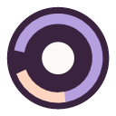
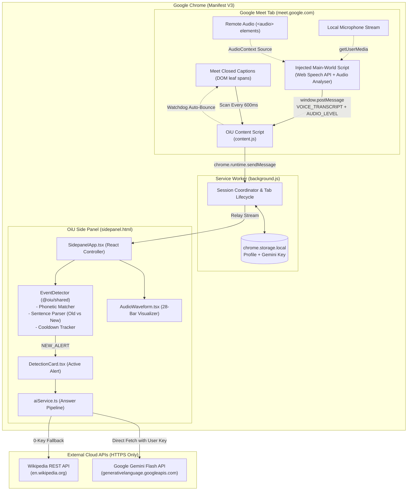

# <p align="center"> OiU — Meeting Awareness Copilot</p>

<p align="center">
  <strong>Zero-impact, privacy-first Google Meet awareness assistant that catches moments directed at you, recovers lost context, and prepares instant 1-click answers.</strong>
</p>

<p align="center">
  <a href="#-key-features"></a>
  <a href="#-architecture"></a>
  <a href="#-multi-tier-ai-intelligence"></a>
  <a href="#-privacy--security"></a>
  <a href="#-getting-started"></a>
  <a href="#-license"></a>
</p>

---

## 🌟 Why OiU?

During online lectures, viva sessions, client meetings, or standups, people get distracted, multitask, or briefly step away. Traditional meeting recorders and transcription bots are intrusive, join as visible bots (`"Otter.ai is recording"`), and produce generic transcripts hours after the call is over.

**OiU is fundamentally different:**
- 🚫 **Zero Bots**: No third-party participant joins your call.
- 🔒 **100% Client-Side Privacy**: Runs completely inside your Chrome browser. No audio is ever recorded, saved, or uploaded to a central server.
- ⚡ **Instant Attention Layer**: Wakes you up with a gentle audio chime the millisecond your name, roll number, attendance call, or question is spoken.
- 💡 **Instant Spoken Responses**: Provides 3 grounded, spoken-ready responses (Direct, Professional, Clarification) powered by Google Gemini 1.5/2.0 Flash or real-time offline knowledge dictionaries.

---

## ✨ Key Features

### 🎧 1. Dual-Engine Audio & Speech Capture
* **Google Meet Neural STT**: Taps Google Meet's internal, server-side caption engine for 100% accurate, low-latency, and speaker-attributed transcripts (identifies who asked the question).
* **In-Origin Web Speech Engine**: Injects a lightweight `webkitSpeechRecognition` listener to continuously capture spoken microphone audio.
* **Real-Time Web Audio Waveform**: 28-bar animated visualizer connected directly to Web Audio `AnalyserNode` frequency bins. Pulses in real time whenever anyone in the call speaks.
* **Self-Healing Caption Watchdog**: Google Meet captions frequently stall during pauses. OiU monitors audio activity—if speech is detected but Meet captions stall for $>15$s, it automatically bounces Meet's caption stream (`OFF -> 250ms -> ON`) to reconnect Google's STT server without interrupting the call.

### 🎯 2. Intelligent Attention & Dialogue Engine
* **Phonetic & Skeleton Matcher (`matcher.ts`)**:
  * Employs Levenshtein distance, phonetic normalization (collapses sound-alikes like `ph/f`, `th/t`, `ee/i`), and consonant-skeleton extraction to catch accents and speech-to-text acoustic misinterpretations (e.g., *"Tathagat"* vs *"The target"*).
  * Strict boundary validation avoids confusing other names (e.g., participant `"ryan"` will never trigger an alert for user `"Aryan"`).
* **Roll Number & Identifier Detection**: Identifies single digits, spaced numbers (*"one one seven"* / *"1 1 7"*), and alphanumeric IDs.
* **Custom Keyword Triggers**: Monitor custom words like `"Attendance"`, project names, or viva topics with instant activation.
* **Dialogue Continuity Analysis (`sentenceParser.ts`)**:
  * Accurately distinguishes **old completed sentences** from **live active utterances**.
  * Recognizes connective speech prefixes (*"tatha"*, *"aur"*, *"and"*, *"also"*) as thoughts continuing from the previous question.
  * Discards questions addressed to other participants (*"Swagat, what is your answer?"*).

### 🤖 3. Multi-Tier AI Intelligence
* **Tier 1 — Google Gemini Flash**: Integrates directly with `gemini-1.5-flash` and `gemini-2.0-flash` via HTTPS with sub-second latency. Prompts are strictly grounded in the meeting excerpt to eliminate hallucinations.
* **Tier 2 — Universal Wikipedia REST API**: Free, 0-API-key fallback that queries Wikipedia's knowledge graph in ~120ms to provide accurate definitions for academic, technical, or viva questions.
* **Tier 3 — 0ms Instant Knowledge Dictionary**: Built-in curated definitions for 50+ core scientific and technical topics (Mitochondria, Photosynthesis, Atoms, Molecules, APIs, Data, etc.) with zero latency.
* **3 Actionable Formats**:
  1. `Direct`: 1-2 sentence crisp factual answer.
  2. `Professional`: Articulate, polite, and contextual response.
  3. `Clarification`: Natural follow-up when meeting context was incomplete.
* **1-Click Copy**: Instant clipboard copy with tactile visual checkmarks.

---

## 🏗️ Architecture



---

## 📂 Project Structure

OiU is organized as a clean **npm monorepo workspace**:

```text
OiU/
├── packages/
│   ├── shared/                 # Core detection logic, types & utilities
│   │   ├── src/
│   │   │   ├── detection/      # detector.ts, matcher.ts, sentenceParser.ts
│   │   │   └── types/          # profile.ts, session.ts, events.ts, messages.ts
│   │   └── test/               # 22 automated unit tests
│   │
│   ├── extension/              # Chrome Extension MV3 source
│   │   ├── public/manifest.json# Manifest V3 definition
│   │   ├── src/
│   │   │   ├── background/     # Service worker
│   │   │   ├── content/        # DOM caption scanner & main world injector
│   │   │   ├── services/       # aiService.ts (Gemini + Wikipedia)
│   │   │   ├── popup/          # Extension toolbar action popup
│   │   │   └── sidepanel/      # Side panel React application
│   │   └── dist/               # Built Chrome extension bundle
│   │
│   └── server/                 # Optional standalone WebSocket/REST backend
└── OIU_PROJECT_AUDIT.md        # Complete technical audit & assessment report
```

---

## 🚀 Getting Started

### Prerequisites
* **Google Chrome** (v114+ recommended for native Side Panel support).
* **Node.js** (v18 or higher) & **npm**.

### 1. Clone & Install Dependencies
```bash
git clone https://github.com/your-username/OiU.git
cd OiU
npm install
```

### 2. Build the Extension
```bash
npm run build
```
This compiles `@oiu/shared`, bundles `@oiu/extension` with Vite into `packages/extension/dist/`, and prepares `@oiu/server`.

### 3. Load into Google Chrome
1. Open Google Chrome and navigate to `chrome://extensions/`.
2. Enable **Developer mode** using the toggle in the top-right corner.
3. Click **Load unpacked**.
4. Select the build directory:
   ```text
   c:\Projects\OiU\packages\extension\dist
   ```
5. The **OiU - Meeting Awareness Assistant** extension will now appear in your toolbar!

---

## 🛠️ Usage Guide

### 1. Configure Your Profile
1. Click the **OiU** icon in your toolbar and open the **Side Panel** (or click the Settings gear icon `⚙️`).
2. Enter your:
   * **Display Name**: Your primary name (e.g., `Aryan`).
   * **Aliases**: Phonetic variations or nicknames (e.g., `Tathagat, Tatha, Ari`).
   * **Identifiers**: Roll numbers, student IDs, or employee codes (e.g., `117, CS117`).
   * **Custom Keywords**: Words you want monitored (e.g., `Attendance, Viva, Project`).
3. *(Optional)* Paste your free [Google AI Studio Gemini API Key](https://aistudio.google.com/apikey) for instant smart responses.

### 2. Join a Meeting & Start Listening
1. Join any call on [Google Meet](https://meet.google.com).
2. Click **Start Listening** in the OiU Side Panel dock.
3. Google Meet captions will automatically turn on, and the green audio waveform will start dancing when participants speak.

### 3. Catching Alerts & Answering
* When someone calls your name or asks you a question, OiU sounds a gentle chime and presents the **Alert Card**.
* Choose between **Direct**, **Professional**, or **Clarification** suggestions.
* Click **Copy** to paste your response into the chat or read it aloud naturally.
* If Meet captions ever pause, tap the **Refresh (🔄)** or **⚡ Kickstart** button to revive the stream in $< 300$ms.

---

## 🧪 Testing & Verification

OiU is backed by automated unit tests covering fuzzy matching, phonetic transformation, sentence separation, and AI suggestion generation:

```bash
# Run all workspace unit tests
npm test

# Run TypeScript typechecks
npm run typecheck

# Build all packages
npm run build
```

| Test Suite | Tests | Result |
| :--- | :---: | :---: |
| `@oiu/shared` (Matcher, Detector, Sentence Parser) | 22 | ✅ PASS |
| `@oiu/server` (Health check & routing) | 1 | ✅ PASS |
| `@oiu/extension` (aiService & Knowledge Resolution) | 7 | ✅ PASS |

---

## 🔐 Privacy & Security Guarantees

* **Zero Recording**: OiU does **not** record, save, or store raw audio files.
* **Zero Remote Forwarding**: Meeting audio and captions remain inside your browser. No data is sent to private backends or third-party servers.
* **Scoped Permissions**: Utilizes strictly scoped Manifest V3 permissions (`sidePanel`, `storage`, `tabs`, `activeTab`, `scripting`, `notifications`).
* **Ephemeral Context**: Transcripts and alert logs reside only in browser runtime memory and are cleared as soon as you click **Stop Listening**.

---

## 🗺️ Roadmap

- [x] Chrome Manifest V3 Side Panel architecture.
- [x] Dual-engine transcription (Google Meet neural captions + Web Speech API).
- [x] Phonetic normalizer and consonant-skeleton fuzzy matching.
- [x] Stalled caption auto-reviving watchdog.
- [x] Google Gemini 1.5/2.0 Flash integration + Wikipedia fallback.
- [x] Real-time Web Audio API frequency visualizer.
- [ ] Meeting context brief / "Summarize meeting so far" on demand.
- [ ] Microsoft Teams Web and Zoom Web platform adapters.
- [ ] 1-Click Markdown export of meeting key points and decisions.

---

## 📄 License

This project is licensed under the **MIT License** — see the [LICENSE](LICENSE) file for details.

---

<p align="center">
  Built with ❤️ for focused students, professionals, and remote teams.
</p>

